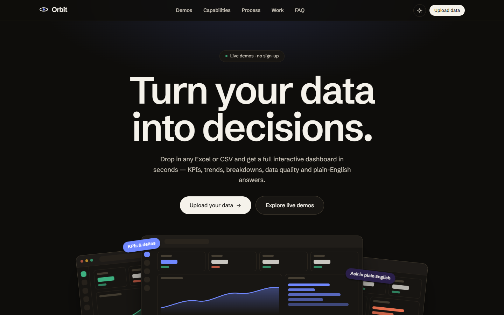
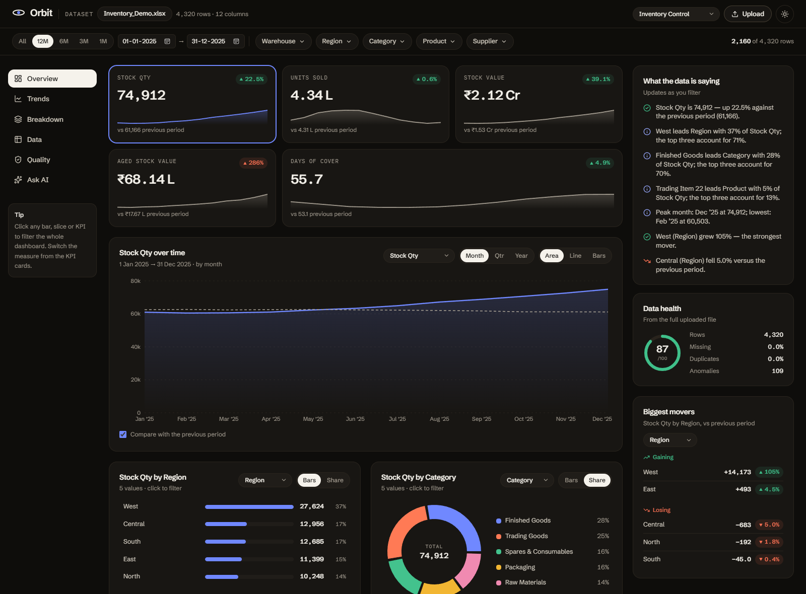
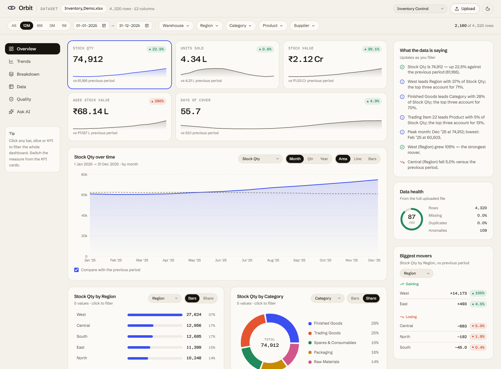
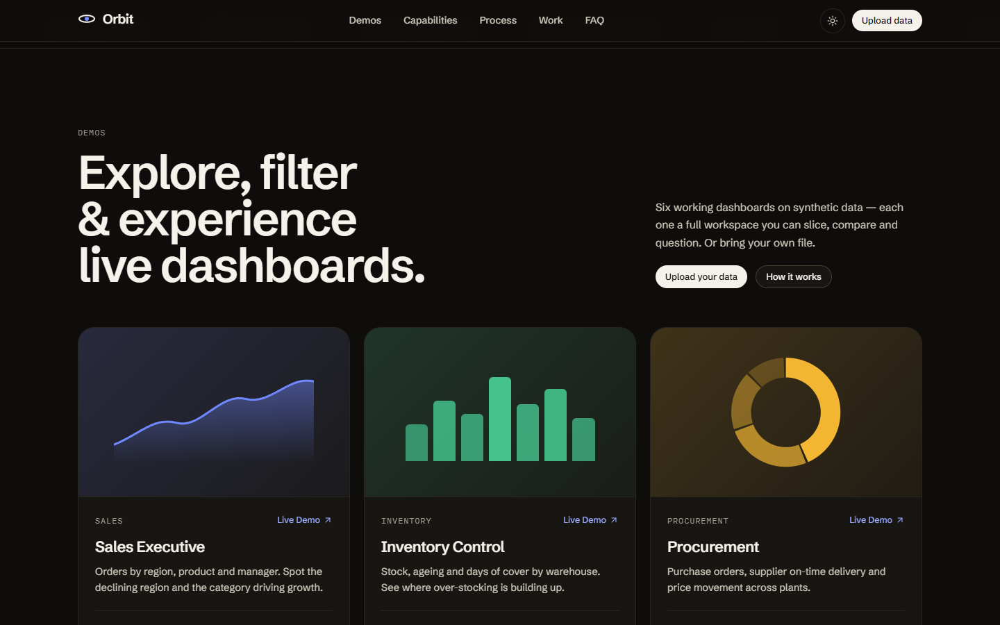
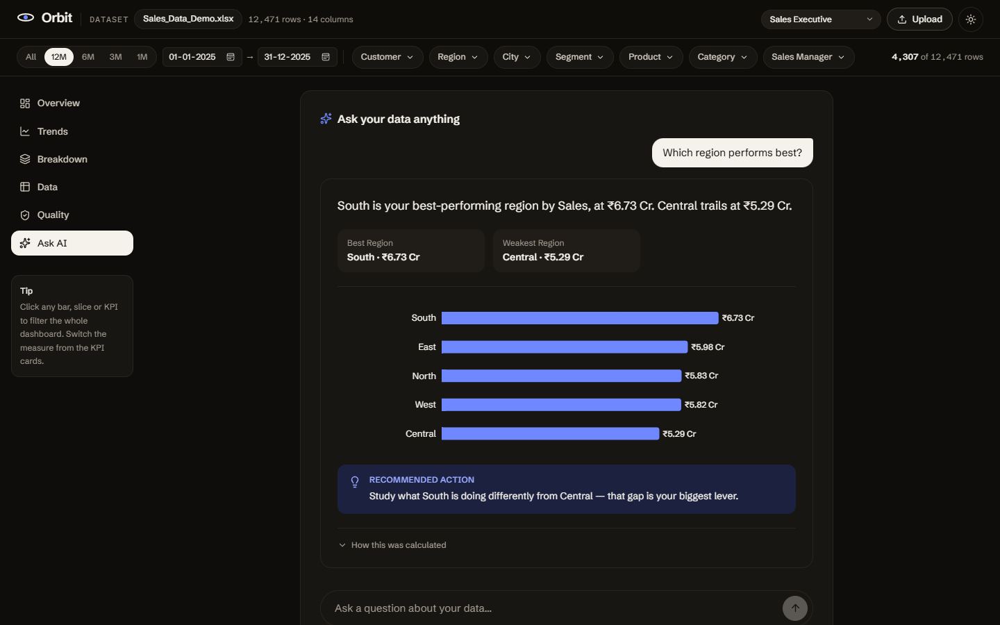

# Orbit

**Upload your Excel or CSV. Get a full interactive dashboard in seconds.** Orbit reads whatever spreadsheet you give it, detects what is in it, and opens a workspace you can slice, compare and question — KPIs, trends, breakdowns, heatmaps, a data-quality profile, and plain-English answers.

> Turn Your Data Into Decisions.



## What it does

1. **Upload or open a demo** — drag in a `.xlsx` / `.xls` / `.csv`, or open one of six live demos (Sales, Inventory, Procurement, Finance, HR, Manufacturing). Every demo dataset is **entirely synthetic** — see `backend/scripts/`.
2. **Analyse** — the backend detects the date column, the numeric measures (and whether each is a total, an average or a point-in-time snapshot) and the categories, and scores data health.
3. **Explore** — a full-screen workspace opens. Every chart, KPI and insight is computed **in the browser** from the dataset, so filters respond instantly:
   - **Overview** — KPI cards with period-over-period deltas and sparklines, a trend with a dashed previous-period overlay, ranked bars and share donuts that double as slicers, a dimension × month heatmap, "biggest movers", and live insights.
   - **Trends** — stacked / multi-line trend split by any dimension, plus every measure at a glance.
   - **Breakdown** — a matrix of every measure by any dimension, sortable, with totals.
   - **Data** — the underlying rows: search, sort, paginate, export the filtered rows to CSV.
   - **Quality** — health score and a profile of every column (completeness, distribution, top values).
   - **Ask AI** — plain-language questions answered from the data.
4. **Light and dark** themes.









## Architecture

```
React (Vite)  ──upload / demo id──▶  FastAPI  ──▶  pandas: schema detection, health, columnar payload
      ▲                                                        │
      └──────────── dataset (gzipped columnar JSON) ◀──────────┘
      │
      └─ in-browser "cube": filters, aggregation, period comparison, insights  (src/lib/cube.js)

Ask AI:  React ──▶ FastAPI ──▶ intent detection ──▶ pandas ──▶ AI phrases the answer (optional)
```

**No database.** Every request re-parses the uploaded file (or loads the bundled demo) from scratch, so there is no session state to lose when a free-tier instance restarts and nothing of yours is stored. `/api/data/analyze` returns the dataset itself — dictionary-encoded dimensions and numeric columns — capped at 60,000 rows (an even, deterministic sample above that, flagged in the UI) so the browser can do all filtering locally. Every number is computed deterministically; the AI provider's only job is to phrase a sentence around numbers that already exist.

The AI provider is swappable without touching any route or service code:

```
AIService
  ├── DemoProvider    (default — deterministic templates, zero cost, zero API key)
  └── GeminiProvider  (AI_MODE=live — calls Gemini's free tier, falls back to DemoProvider on any failure)
```

**Frontend**
```
frontend/src/
  pages/
    Home.jsx              # landing: hero, demos gallery, process, capabilities, work, FAQ
    Workspace.jsx         # /dashboard — top bar, filter bar, tabs; /dashboard?demo=<id> deep-links a demo
  components/
    workspace/            # Overview, Tabs (trends/breakdown/data/quality/ask), FilterBar, charts
    home/                 # UploadPanel, illustration art
    ai/                   # AIChat, AIResponseCard — "Ask AI"
    layout/, ui/          # Navbar, Footer, ThemeToggle, buttons, cards, segmented controls
  lib/
    cube.js               # columnar engine: masks, group-by, time series, comparison, heatmap, CSV
    insights.js           # live "what the data is saying" generation
    fmt.js                # Indian-style ₹ / L / Cr formatting and date helpers
  state/DatasetContext.jsx  # the dataset currently open (demo or upload) + its cube
  theme/ThemeProvider.jsx   # light / dark tokens (CSS variables)
  config/demos.js           # demo catalogue, work stories, FAQ copy
  config/brand.js           # change BRAND_NAME here to re-skin the whole site
```

**Backend**
```
backend/
  app/
    main.py                          # FastAPI app, CORS, gzip, rate-limit middleware
    api/routes/
      data.py                        # GET /api/data/samples, POST /api/data/analyze, POST /api/data/ask
      health.py
    services/
      data_analysis_service.py       # column-role detection, health score, KPIs, insights,
                                      # and the columnar dataset payload — the engine
      ai_service.py                  # intent detection + context-building for "Ask AI"
      providers/                     # base.py, demo_provider.py, gemini_provider.py
      rate_limiter.py                # in-memory daily AI limit + short-lived answer cache
    data/sample_*_data.csv           # the six bundled, synthetic demo datasets
  scripts/
    generate_sample_data.py          # regenerates the Sales demo
    generate_demo_datasets.py        # regenerates the other five (inventory, procurement, ...)
```

## Local Development

### Frontend

```bash
cd frontend
npm install
npm run dev          # http://localhost:5173
```

### Backend

No database required.

```bash
cd backend
python3 -m venv .venv && source .venv/bin/activate
pip install -r requirements.txt
cp .env.example .env

uvicorn app.main:app --reload --port 8000
```

Point the frontend at it with `VITE_API_BASE_URL` (defaults to `/api`, proxied to `localhost:8000` in dev — see `frontend/vite.config.js`).

To regenerate the bundled demo datasets:

```bash
python scripts/generate_sample_data.py          # Sales
python scripts/generate_demo_datasets.py       # Inventory, Procurement, Receivables, Workforce, Manufacturing
```

### Environment variables

**Backend** (`backend/.env`, see `backend/.env.example`):

| Variable | Default | Purpose |
|---|---|---|
| `AI_MODE` | `demo` | `demo` (free, deterministic) or `live` (calls Gemini) |
| `GEMINI_API_KEY` | — | required for `AI_MODE=live` |
| `AI_DAILY_LIMIT` | `5` | "Ask Your Data" questions per client per day |
| `AI_MAX_PROMPT_LENGTH` | `300` | max question length |
| `AI_REQUEST_TIMEOUT_SECONDS` | `15` | timeout for the AI provider call |
| `CORS_ALLOWED_ORIGINS` | localhost | comma-separated allowed frontend origins |
| `MAX_REQUEST_BODY_BYTES` | 10MB | request body cap (uploads are separately capped at 8MB in `api/routes/data.py`) |
| `BRAND_NAME` | `Orbit` | change once, the API identity follows |

**Frontend** (`frontend/.env`, optional):

| Variable | Default | Purpose |
|---|---|---|
| `VITE_API_BASE_URL` | `/api` | backend base URL |
| `VITE_BRAND_NAME` | `Orbit` | change once, the whole site follows (see `src/config/brand.js`) |

Never commit `.env`. Only `.env.example` files are tracked.

## Deployment (free tier, $0/month)

Two services, both with permanent free tiers and no credit card: **Render** (FastAPI, via the [`render.yaml`](render.yaml) blueprint in this repo) and **Vercel** (frontend, via [`frontend/vercel.json`](frontend/vercel.json) for SPA routing). No database needed.

1. **Backend — [render.com](https://render.com)**
   New → Blueprint → connect this repo. Render reads `render.yaml` and configures the service automatically. `GEMINI_API_KEY` and `CORS_ALLOWED_ORIGINS` are left out of the blueprint on purpose — set them in the dashboard (Gemini's key is optional, only needed for `AI_MODE=live`; leave `CORS_ALLOWED_ORIGINS` blank for now, come back after step 2).

   Deploy, then note the resulting URL (`https://orbit-api-xxxx.onrender.com`).

2. **Frontend — [vercel.com](https://vercel.com)**
   New Project → import this repo → set **Root Directory** to `frontend`. Add an environment variable `VITE_API_BASE_URL` = `https://orbit-api-xxxx.onrender.com/api` (your Render URL from step 1, with `/api` appended). Deploy, then note the resulting URL.

3. **Close the loop** — back in Render, set `CORS_ALLOWED_ORIGINS` to your Vercel URL from step 2 and save (triggers a redeploy).

4. **Keep the backend warm (optional but recommended)** — Render's free tier sleeps after 15 minutes idle, giving the first visitor after a quiet spell a 30-60s wait. This repo includes [`.github/workflows/keep-alive.yml`](.github/workflows/keep-alive.yml), which pings `/health` every 10 minutes. Add a repository secret named `BACKEND_HEALTH_URL` (Settings → Secrets and variables → Actions) set to `https://orbit-api-xxxx.onrender.com/health` and it starts working immediately — no code change needed. (GitHub Actions minutes are unlimited on public repos.)

> **Already have a Neon Postgres database from an earlier version of this project?** It's no longer used — this build has no database dependency. You can delete the `DATABASE_URL` environment variable from your Render service, and delete or pause the Neon project, with no effect on the site.

## Demo Mode / Live AI Mode

- **`AI_MODE=demo`** (default): the analysis engine (KPIs, charts, insights) is always real, computed from the actual uploaded data. "Ask Your Data" answers are phrased with a deterministic template instead of calling an external model. No API key needed.
- **`AI_MODE=live`**: the same computed numbers are handed to Gemini's free tier to phrase more naturally. If that call fails for any reason (quota, network, invalid key), it transparently falls back to the demo template rather than breaking the response.

This is why the live site can sit on a free-tier host indefinitely without an AI bill.

## Security & abuse safeguards

- Server-side only API keys — never exposed to the frontend, never called directly from the browser.
- Per-client daily AI question limit (`AI_DAILY_LIMIT`), plus a general per-IP request-rate limiter.
- Uploaded files are capped at 8MB and validated by extension and content before parsing; unreadable or empty files return a clear error instead of a crash.
- Maximum prompt/response length and request timeout on every AI call.
- Short-lived answer cache, keyed by the specific dataset's content hash plus the question — so repeated questions don't re-invoke the AI provider, and a cached answer for one file is never served for a different one.
- The AI layer only ever explains numbers `data_analysis_service.py` already computed with pandas — it never computes or invents a number itself.
- CORS allowlist, request body size limit, and a generic error response for unhandled exceptions (real errors are logged server-side, never shown to the user).

## Tech stack

React · Vite · Tailwind CSS · Recharts · Framer Motion · FastAPI · Python/Pandas · Gemini API

## License

MIT
